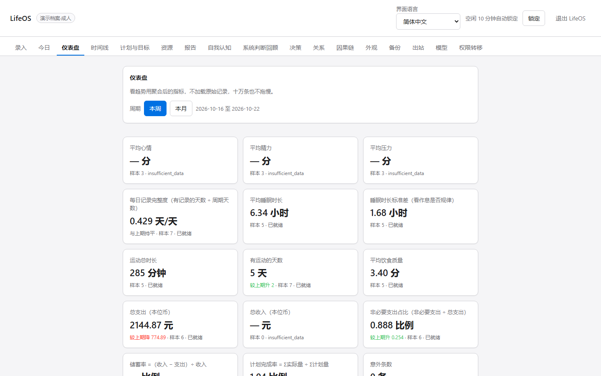
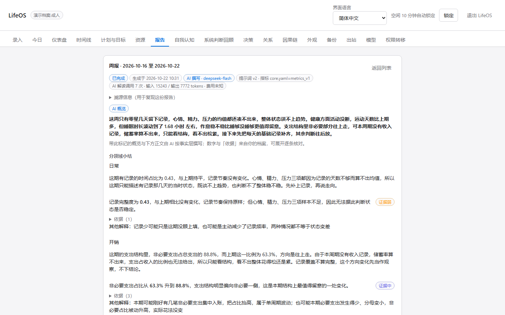
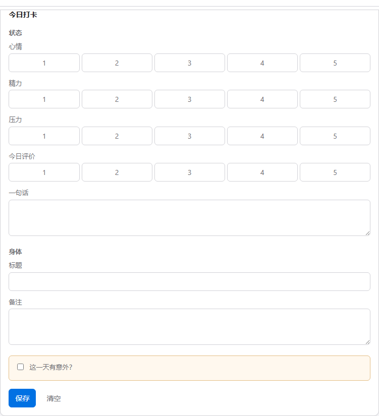
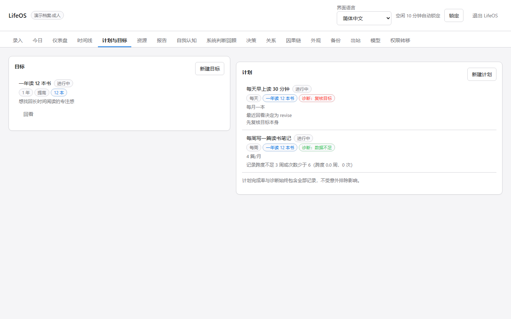
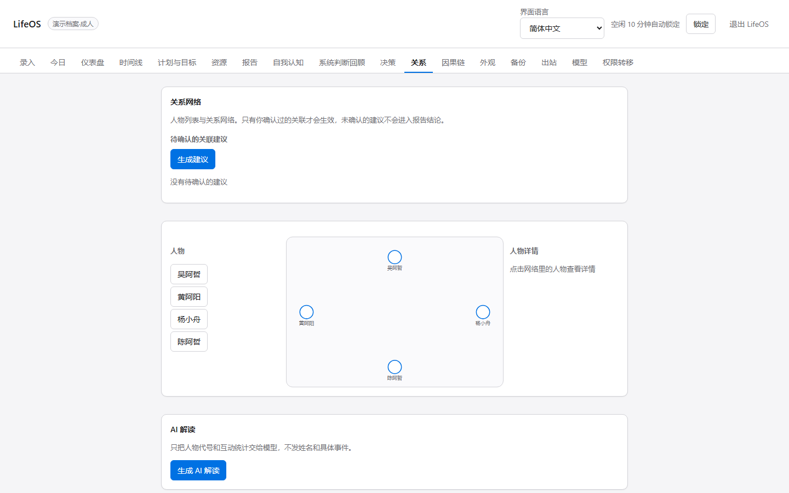
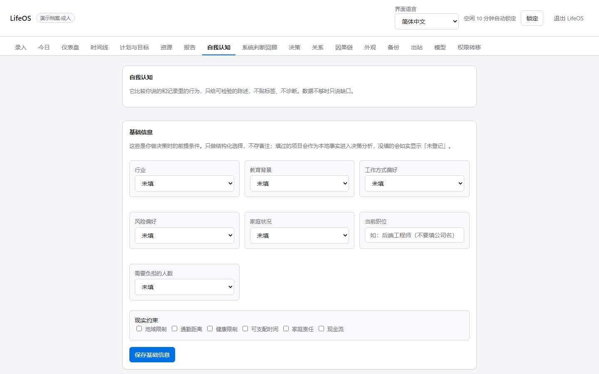
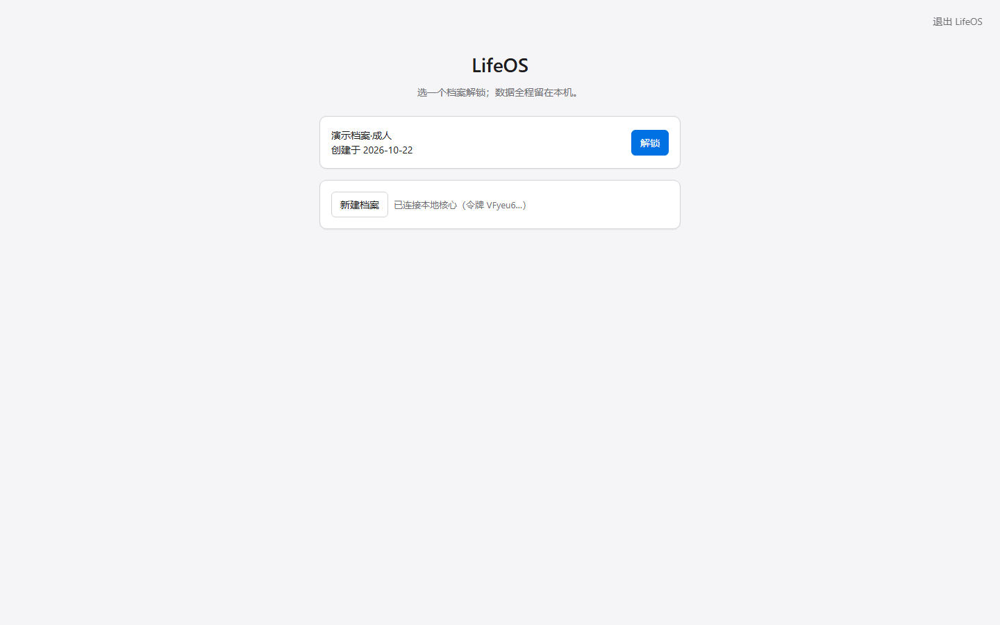

# LifeOS · 把人生数字化，让 AI 真正帮上你

[简体中文](README.md) | [English](README.en.md)

[](https://github.com/ydsgangge-ux/LifeOS/actions/workflows/ci.yml)
[](LICENSE)

> 你和 AI 之间的差距，从来不是模型聪不聪明，
> 而是它对你一无所知。

---

## 界面预览

> 以下截图全部来自 `scripts/seed.py` 生成的**演示档案（假数据）**，不含任何真实记录。



| 报告：先给结论，证据折叠成人话 | 今日打卡：表单由 YAML 定义 |
| --- | --- |
|  |  |

| 计划与目标：诊断「做了有没有靠近目标」 | 关系网络：人物只用代号 |
| --- | --- |
|  |  |

| 自我认知：基础信息由你自己填 | 解锁页：口令或恢复密钥 |
| --- | --- |
|  |  |

## 一、AI 时代，先数字化的人先受益

今天所有人的 AI 都是同一个 AI。可产出的东西天差地别——差别不在提示词技巧，在于**你给了它多少关于「你」的事实**。

没有记录，你得到的永远是通用建议：「保持规律作息」「建议复盘目标」。
有记录，它才能说：「你过去 6 个月启动了 7 个计划，其中 2 个标为完成；没完成的 5 个，都在第 3 周前后停了。」

第二种回答，模型编不出来。它只能从你留下的东西里读出来。

**所以越早开始记录，领先越多。** 你的「个人数据集」是靠时间攒的：

- 三个月的睡眠，能看出季节性的波动；三周的睡眠，只能看出你昨晚没睡好；
- 一年的开销，能看出结构性浪费；一个月的开销，只能看出这个月手紧；
- 五年的计划完成率，能看出你反复卡在哪一类事情上；一个季度，看不出任何规律。

数据不能倒推。等到某天你想复盘「这几年我到底怎么过的」，才发现**最早的那一天已经错过了**——你能做的只是从今天开始攒第一条。

这不是又一个记账 App，也不是自律打卡器。它是**一份只属于你、可以长期喂给 AI 的档案**：把日常、开销、睡眠、计划、关系、想法都放进同一条时间线，然后诚实地告诉你——**你实际在过的生活，和你以为的自己，差在哪里**。

## 二、但它首先得是你敢写的东西

想让 AI 了解你，前提是你愿意把真实的东西写下来。所以这个程序先把「敢写」解决了：

- **数据不出机器。** 只监听 `127.0.0.1`，每次运行一个随机端口；出站默认全部关闭，
  连一句总结都不会发给任何服务器。想用 AI 解读，得你自己在设置里显式打开。
- **文件是密文。** 每个档案一个独立的加密数据库（SQLCipher 整库加密）。
  不输入口令，直接去读文件字节——看不到任何明文，连表名都看不到。
  （怎么验证的：[ADR-02](docs/adr/ADR-02-sqlcipher.md)）
- **口令不是唯一活路。** 创建档案时给一串一次性恢复密钥。口令忘了、密钥还在，数据就在；
  两个都丢了，数据是真的回不来——这是设计，不是 bug。
- **它不给你贴标签。** 不说「你性格是…」，只说「过去 6 个月你启动了 7 个计划，其中 2 个标为完成」。
  数字是程序算的，措辞才是 AI 的事。

## 三、它怎么和 AI 协作

一句话：**你负责记录事实，程序负责算数，模型只负责解释。**

```text
你的记录  →  程序算出事实层（计数 / 分布 / 趋势 / 周月年对比）  →  AI 解读  →  你看到人话
```

- **模型不碰原始明细。** 出站的是结构化事实：次数、活跃天数、状态分布、转化数、时长、比例。
  人名、备注、日记与梦境原文、`income.total` 一律不出站，敏感字段还会被扫描丢弃。
- **数字一定可追溯。** 结论里的每个数都来自事实层对应条目，不是模型自己加出来的；
  正文里出现手写数字、未核实却被标成「强证据」、因果措辞，都会被校验器拦下。
- **没有 AI 也能用。** 没配 Key、没网、出站策略选「不外发」时，报告自动转本地规则版，
  并明确告诉你「本地模式、已降级」，不会伪造结论。
- **出站只有三档**：完全不出站（儿童/青少年档永久锁死）、仅聚合事实、以及你自己逐次确认。

换句话说：**AI 拿到的是关于你的「统计摘要」，不是你的日记。** 这既是隐私边界，也是让结论可信的原因。

## 四、现在能做什么

- 建档案（成人 / 青少年 / 儿童三个年龄档）、解锁、锁定、改口令、销毁
- 按表单录入：日常、收入、开销、资源、目标回看、关系、健康、学习、事业、兴趣、计划打卡、想法、梦境（第 5 章 13 个领域）——表单是 YAML 写的，改文件就改界面
  人物 / 爱好 / 技能 / 长期目标 / 计划 / 资源用选择器直接挑，没有就先就地新建，不用记住任何 id
- 资源与资产台账：只登记大件和抽象存量（房车、资金池、可支配时间、精力），日常小额收支走收入/开销；存量变化时记一笔，余额自动累加
- 记录「意外」：不是异常处理，是记录的一部分。它单独统计，不会被偷偷排除掉
- 浏览最近条目，按领域、日期、关键词、有没有意外筛选
- 报告：周报 / 月报 / 年报，月报带近 6 个自然月趋势，空章节自动隐藏，「依据」折叠成人话
- 报告由 13 个领域分析员分别写小结，再由一次整合调用写成：没数据的领域直接跳过，单个领域失败只降级该领域
- 报告顶部公开本次 AI 调用次数、输入/输出 token 与估算费用，成本可查
- 界面支持简体中文 / English / 日本語 / Español，模型输出跟随界面语言
- 页面级 AI 解读：报告、自我认知、决策、关系四个页面，点一下按钮出结果，并缓存下来
- 附件加密存储

## 五、先跑起来看看

需要 Python 3.12+ 与 Node 22+。**四步，一次搞定：**

```powershell
# 1. 装后端依赖
python -m venv .venv
.venv\Scripts\python.exe -m pip install -e "services/core[dev]"

# 2. 装前端依赖并构建（构建产物由后端同源托管）
cd apps/web
npm install
npm run build
cd ../..
```

> 不想敲这四步？双击仓库根目录的 **`LifeOS-setup.cmd`**：它会先检查 Python / Node 版本，
> 再建虚拟环境、装依赖、构建前端；缺什么会用人话告诉你，装完直接双击 `LifeOS.vbs` 就能用。
> 想连测试和 lint 工具一起装，用 `LifeOS-setup.cmd dev`。

生成一批假数据先看看长什么样（**千万不要把真实数据混进去**）：

```powershell
.venv\Scripts\python.exe scripts/seed.py --data-dir .tmp/demo --profiles 3 --years 3
```

起服务（把数据目录指到刚才的演示库，否则打开的是你真实的 `~/.lifeos`）：

```powershell
$env:LIFEOS_DATA_DIR = ".tmp/demo"
.venv\Scripts\python.exe -m lifeos.api
```

终端会打印一行地址，形如：

```
http://127.0.0.1:51234/#t=xxxxxxxxxxxxxxxxxxxx
```

**用这一整行打开浏览器。** 地址里的 `#t=` 是本次会话的令牌：它不发给服务端、也不进
浏览器历史（页面读到就立刻抹掉）。用演示口令 `lifeos-demo` 解锁「演示档案·成人」就能用了。

> 忘了复制地址？单独打开页面，把令牌粘到首页的输入框里也一样。

## 六、一键启动（给不想敲命令的人）

发布包是**整仓 + 随包 Python**：解开压缩包，双击根目录的 **`LifeOS.vbs`** 就行。

- 它用随包 Python 起一个**只监听 `127.0.0.1`** 的本地核心，然后**自动打开你的默认浏览器**，
  界面直接出现（VBS 脚本调用 `python.exe` 并隐藏窗口，**不弹黑色终端窗口**）。
- `LifeOS.cmd` 是给排障用的：`LifeOS.cmd debug` 会前台运行，日志直接可见；正常使用只需要点 `.vbs`。
- 双击没反应、或想看看它到底卡在哪，双击 **`LifeOS-debug.cmd`**：它在前台运行并把日志留在窗口里，
  出错时会停住等你看完。它不依赖 VBScript，脚本被安全软件拦掉时也能用。
- Python 按「随包便携版 > 仓库 `.venv` > 系统 `PATH`」依次查找；一个都没有时，会用你能看懂的话
  告诉你缺什么，而不是白屏。
- 第一次运行会创建数据目录与空档案库，没有安装向导，也没有「下一步」。
- 想退出时用界面右上角的**退出**按钮——它会真正终止核心进程；**关掉浏览器标签页并不会停服务**
  （界面走的是系统浏览器）。空闲 10 分钟也会自动锁定。

> 上面「从今天开始」里的两条命令是**开发路径**（要从源码跑、改代码时用）。普通人只需要双击那个 `.vbs`。

## 七、目录速览

```
LifeOS/
├─ apps/web/            React 前端（解锁页、表单渲染器、条目列表、报告）
├─ services/core/       Python 核心（FastAPI + SQLCipher）
│  ├─ lifeos/api/        路由与鉴权中间件
│  ├─ lifeos/domain/     实体服务（事务边界在这一层）
│  ├─ lifeos/security/   Argon2id、密钥包装、附件加密、会话锁
│  ├─ lifeos/reporting/  事实层、指标、分领域报告管线、校验与渲染
│  ├─ lifeos/db/         连接工厂、迁移器、0001 初始迁移
│  ├─ lifeos/forms/      YAML 表单加载与动态校验
│  └─ tests/             单测、API 契约与集成测试
├─ schemas/             表单、字典、提示词与指标（前后端共用）
├─ config/              config.toml.example、diagnosis.yaml
├─ scripts/             种子数据、产物扫描、发布包构建
├─ i18n/                四语言词表（前后端同源）
├─ release/             打包产物（双击即用的发布包）
└─ docs/
   ├─ adr/              架构决策记录
   ├─ plans/            分阶段实施计划（P0–P6）
   └─ compliance/       合规核对清单（对外发布前置）
```

## 八、开发

```powershell
# 后端质量门禁（以下四条必须全绿；在 services/core 下用仓库根的 venv）
cd services/core
..\..\.venv\Scripts\python.exe -m ruff check .
..\..\.venv\Scripts\python.exe -m mypy lifeos
..\..\.venv\Scripts\lint-imports.exe
..\..\.venv\Scripts\python.exe -m pytest

# 前端
cd apps/web
npm run lint && npx tsc --noEmit && npm run test
```

组装「双击就能用」的分发包（`release/LifeOS/`，整仓 + 随包便携 Python；要联网取便携 Python 与依赖）：

```powershell
.venv\Scripts\python.exe scripts/build_release.py
```

开发期前端热更新（后端要先起着，端口填真实端口）：

```powershell
$env:LIFEOS_CORE_URL = "http://127.0.0.1:51234"
npm run dev            # http://127.0.0.1:5173
```

几条自己定的规矩，写在这里免得忘：

- 事务边界在 `lifeos/domain/`，路由层不直接碰数据库。
- 只有 `lifeos/llm/` 允许联网，import-linter 会在 CI 里拦住越界。
- 日志里不出现条目内容、金额、人名、提示词。
- 已发布的迁移文件、提示词与指标不许改，只能新增版本（校验器会比对哈希）。

## 九、数据放在哪、怎么删、为什么不用账号

- **数据放在哪**：默认在 `~/.lifeos/`（Windows 上是 `C:\Users\<你>\.lifeos`）。每个档案一个独立的
  **加密数据库**（SQLCipher 整库加密）；备份在**另一个目录** `data/backups/<id>/`，避免档案损坏时
  连备份一起丢。想换位置，设 `LIFEOS_DATA_DIR` 或改 `config.toml.example` 即可。
- **怎么彻底删除**：界面上「销毁档案」需二次确认并输入别名，确认后会**物理删除**该档案的加密库
  与备份目录。删掉程序本身**不会**动 `~/.lifeos/`——想连数据一起清掉，手动删这个目录即可。
- **为什么不用账号**：没有服务端、没有云同步、没有登录。程序只在你本机跑，只监听 `127.0.0.1`，
  出站默认全部关闭。所以**没有**「密码忘了找客服」这条路——口令与一次性恢复密钥都由你自己保管，
  丢了就是真的回不来（这是设计，不是 bug）。

## 十、儿童与家庭模式（对外发布的前置条件）

面向未成年人的相关能力——监护人密钥包装、可见范围、儿童报告变体——有一份单独的
[儿童数据合规核对清单](docs/compliance/child-data-checklist.md)。
它把「代码里已实现、有单测可查」的项与「**发布前必须经法务确认**」的未决项分开列。
**未完成法务确认前，不得对外宣称符合任何法规。**

几条已经写进代码的硬约束，免得忘：儿童/青少年档出站策略**永久锁死**为「完全不出站」；
儿童报告**家长不点就不生成**；监护人看到的内容是**应用层约定，不是密码学隔离**
（监护人持密钥技术上仍可读全部）。

## 许可

MIT License，见 [LICENSE](LICENSE)。可自由使用、修改、分发，保留版权声明即可。
